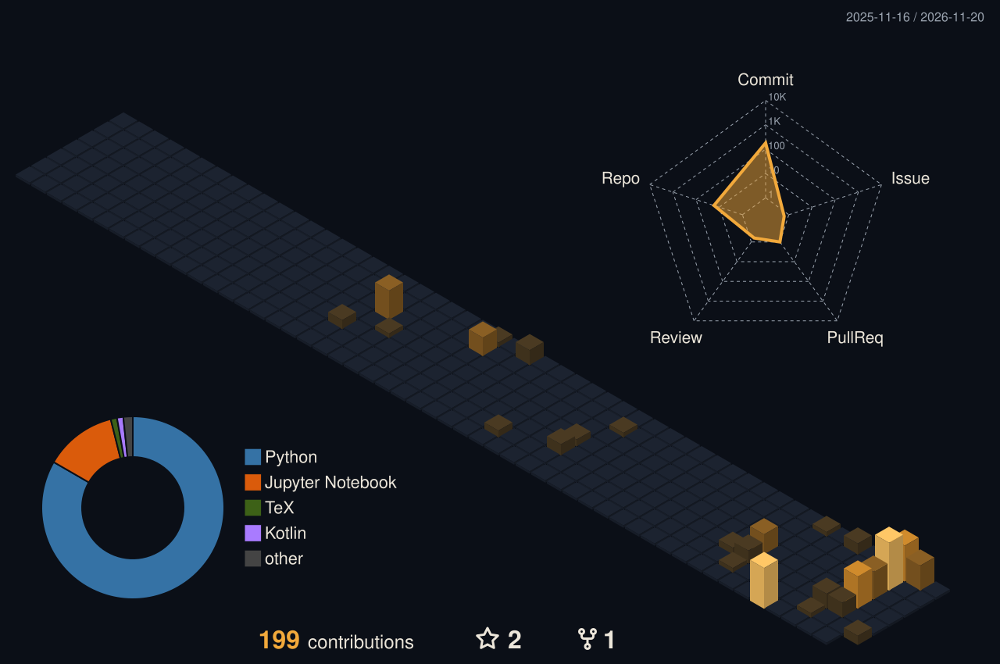

  
  

  
  

## About me

## Certifications

 
 

Click a certificate to view it.

## Tech stack

<h4>Languages</h4>

  

<h4>Machine learning and deep learning</h4>

  
  
  
  
  
  
  
  
  
  

<h4>Generative AI and LLMs</h4>

  
  
  
  
  
  
  
  

<h4>Data engineering and databases</h4>

  
  
  
  
  
  
  

<h4>MLOps, cloud and deployment</h4>

  
  
  
  
  
  

## My contributions in 3D

## GitHub stats

<picture>
  <source media="(prefers-color-scheme: dark)" srcset="https://raw.githubusercontent.com/ArpitThakur7/ArpitThakur7/output/github-snake-dark.svg"/>
  <source media="(prefers-color-scheme: light)" srcset="https://raw.githubusercontent.com/ArpitThakur7/ArpitThakur7/output/github-snake.svg"/>
  
</picture>

